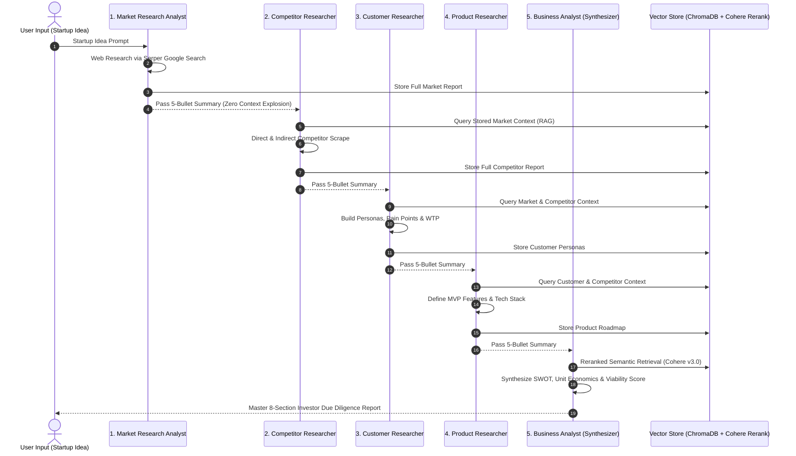
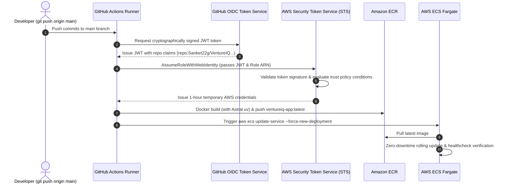

<div align="center">

# 🚀 VentureIQ
### Autonomous Multi-Agent Startup Intelligence & Cloud Delivery Platform
**End-to-End Delivery Flow: From Multi-Agent Architecture to Containerized AWS ECS Fargate via GitHub Actions CI/CD**

[](https://www.python.org/downloads/)
[](https://crewai.com)
[](https://streamlit.io/)
[](https://terraform.io)
[](https://aws.amazon.com/ecs/)
[](https://aws.amazon.com/elasticloadbalancing/)
[](https://github.com/features/actions)
[](LICENSE)

<br/>

<p align="center">
  
</p>

<p align="center">
  <b>An enterprise-grade platform automating venture due diligence and startup intelligence, packaged with Docker, provisioned using Terraform, and continuously delivered to AWS with keyless GitHub Actions OIDC.</b>
</p>

</div>

---

## 📑 Table of Contents
1. [Overview & Core Value](#-overview--core-value)
2. [End-to-End Architecture Flow](#-end-to-end-architecture-flow)
3. [Multi-Agent Swarm (AI Engine)](#-multi-agent-swarm-ai-engine)
4. [Cloud Infrastructure (Terraform & AWS)](#-cloud-infrastructure-terraform--aws)
5. [Keyless CI/CD Pipeline (GitHub Actions + OIDC)](#-keyless-cicd-pipeline-github-actions--oidc)
6. [Repository Structure](#-repository-structure)
7. [Deployment & Operations Guide](#-deployment--operations-guide)
8. [🎯 DevOps & Cloud Interview Guide (Q&A)](#-devops--cloud-interview-guide-qa)

---

## 📌 Overview & Core Value

**VentureIQ** is an autonomous multi-agent intelligence platform that automates venture due diligence, market validation, and competitive research for founders, venture capital analysts, and strategy teams.

Instead of spending **30–50 hours** manually researching market sizing, scraping competitor landing pages, reviewing user forums, and building financial assumptions, **VentureIQ coordinates a swarm of 5 specialized AI agents** that iteratively research, cross-examine, persist findings in a vector database, and synthesize an investor-grade **8-section Master Business Analysis Report**.

The platform is containerized and delivered as a **production-grade AWS microservice** with complete infrastructure-as-code automation and zero-downtime deployment pipelines.

---

## 🏗️ End-to-End Architecture Flow

### 1. Cloud Infrastructure & User Traffic Flow


---

## 🤖 Multi-Agent Swarm (AI Engine)

VentureIQ implements a **Store-and-Summary multi-agent design pattern** to prevent context window explosion across sequential workflows:



### The 5 Autonomous Agents:
| Agent | Role & Goal | Tools | Output Deliverables |
| :--- | :--- | :--- | :--- |
| **1. Market Analyst** | Landscape sizing & market dynamics | Serper Google Search, ChromaDB Store | TAM, SAM, SOM estimates, 5-year CAGR, growth tailwinds. |
| **2. Competitor Researcher** | Competitive intelligence & gaps | Serper Search, ScrapeWebsiteTool, RAG | Direct/indirect competitor matrix, feature flaws, pricing gaps. |
| **3. Customer Researcher** | Personas & buyer psychology | Serper Search, ScrapeWebsiteTool, RAG | ICP personas, top 5 verified pain points, willingness-to-pay tiers. |
| **4. Product Researcher** | Technical specification & MVP | Serper Search, ScrapeWebsiteTool, RAG | MoSCoW MVP feature scope, architecture stack, 3-phase roadmap. |
| **5. Business Analyst** | Due diligence & investment thesis | Cohere Reranked Semantic RAG | Master 8-section investor brief, SWOT, unit economics, viability score (1–10). |

---

## ☁️ Cloud Infrastructure (Terraform & AWS)

The infrastructure is written entirely in **Terraform (HCL)** and split into two isolated modules:

### 1. `infra/bootstrap/` — Remote State & Identity Foundation
* **S3 Remote State Backend**: Provisions encrypted state bucket `ventureiq-tf-state-060002399291` with versioning and AES-256 server-side encryption.
* **GitHub Actions OIDC Provider**: Configures AWS OpenID Connect trust (`token.actions.githubusercontent.com`) for keyless authentication.
* **IAM Role (`ventureiq-github-actions-role`)**: Dynamically assumed by GitHub workflows based on repository subject claims (`repo:Sanket22g*/VentureIQ*:*`).

### 2. `infra/app/` — Production Application Architecture
* **Virtual Private Cloud (VPC)**:
  - CIDR: `10.0.0.0/16` deployed across 2 Availability Zones (`ap-south-1a`, `ap-south-1b`).
  - 2 Public subnets (`10.0.1.0/24`, `10.0.2.0/24`) for Load Balancers and NAT.
  - 2 Private subnets (`10.0.3.0/24`, `10.0.4.0/24`) for isolated container tasks.
  - Single NAT Gateway balancing cost efficiency with outbound API access.
* **Application Load Balancer (ALB)**:
  - Public HTTP (Port 80) listener routing to an IP-targeted ECS Target Group.
  - **600s Extended Idle Timeout**: Streamlit WebSockets remain open during long-running multi-agent reasoning chains without dropping.
  - **Session Stickiness (`lb_cookie`)**: Guarantees users stay connected to the same container instance during interactive sessions.
  - Native health checks against `/_stcore/health`.
* **Security Groups**:
  - `ventureiq-alb-sg`: Accepts public inbound traffic on HTTP port 80.
  - `ventureiq-ecs-sg`: Strictly restricts inbound port 8501 to traffic originating exclusively from the ALB security group. Outbound allowed for LLM APIs.
* **Amazon ECR Repository**:
  - `ventureiq-app` with automated image scanning on push.
  - Lifecycle policy retaining the 5 latest images to prevent storage bloat.
* **ECS Fargate Compute**:
  - Task Definition: 1 vCPU (1024 CPU units), 3 GB RAM (3072 MB) to support in-memory ChromaDB operations and CrewAI reasoning chains.
  - Desired count: 1 (scalable up to 5 instances).
* **AWS SSM Parameter Store (Secrets)**:
  - Encrypted `SecureString` parameters for `GROQ_API_KEY`, `SERPER_API_KEY`, and `COHERE_API_KEY`. Injected into task definitions at launch.
* **CloudWatch Logs**:
  - Log group `/ecs/ventureiq` with 14-day automated retention.

---

## 🔄 Keyless CI/CD Pipeline (GitHub Actions + OIDC)

Instead of storing permanent AWS access keys in GitHub Secrets, VentureIQ implements **short-lived, keyless OIDC authentication**:



### GitHub Actions Workflows:
1. **`deploy.yaml`**: Triggers on code changes (`src/**`, `frontend/**`, `Dockerfile`). Builds container with Astral `uv`, tags, pushes to ECR, and executes an ECS rolling deployment.
2. **`infra.yaml`**: Triggers on changes to `infra/app/**`. Runs `terraform fmt`, `terraform validate`, `terraform plan`, and `terraform apply`.
3. **`destroy.yaml`**: Manual workflow with confirmation parameter to cleanly tear down AWS resources and prevent unnecessary cloud costs.

---

## 📂 Repository Structure

```
VentureIQ/
├── .github/
│   └── workflows/
│       ├── deploy.yaml              # Builds Docker image, pushes to ECR, updates ECS
│       ├── infra.yaml               # Terraform fmt, validate, plan, apply on infra/app
│       └── destroy.yaml             # Teardown workflow to stop AWS billing
├── frontend/
│   ├── .streamlit/config.toml       # Streamlit UI & theme configurations
│   ├── app.py                       # Interactive analytics dashboard & telemetry
│   └── requirements.txt             # Lightweight frontend dependencies
├── infra/
│   ├── bootstrap/                   # S3 state bucket & GitHub Actions OIDC role
│   │   ├── main.tf
│   │   ├── variables.tf
│   │   └── outputs.tf
│   └── app/                         # VPC, ALB, ECR, ECS Fargate, SSM, CloudWatch
│       ├── main.tf
│       ├── variables.tf
│       └── outputs.tf
├── src/
│   └── crew_5_rag/
│       ├── config/
│       │   ├── agents.yaml          # Agent roles, goals, and backstories
│       │   └── tasks.yaml           # Sequential task definitions & expected outputs
│       ├── tools/
│       │   └── custom_tool.py       # ChromaDB store & Cohere reranking RAG tools
│       ├── crew.py                  # CrewBase orchestration & tool bindings
│       └── main.py                  # CLI pipeline entry point
├── Dockerfile                       # Multi-stage Astral uv + Python 3.11-slim image
├── .dockerignore                    # Excludes .git, .env, .venv, local caches
├── pyproject.toml                   # Project dependencies and packaging
├── uv.lock                          # Deterministic dependency lockfile
└── README.md                        # Documentation
```

---

## 🚀 Deployment & Operations Guide

### 1. Prerequisites
* AWS Account with an IAM administrative user configured locally (`aws configure`).
* Terraform `>= 1.5.0` installed.
* GitHub Repository configured.

### 2. Step 1: Bootstrap Remote State & OIDC (One-Time Setup)
```powershell
cd infra/bootstrap
terraform init
terraform apply -auto-approve
```
*Outputs: `state_bucket_name` and `github_actions_role_arn`.*

### 3. Step 2: Configure GitHub Secrets
In your GitHub repo under **Settings âž” Secrets and variables âž” Actions âž” Secrets**, add:
* `AWS_ROLE_ARN`: Output from bootstrap (e.g. `arn:aws:iam::060002399291:role/ventureiq-github-actions-role`)
* `GROQ_API_KEY`: Primary LLM API key
* `SERPER_API_KEY`: Google Search API key
* `COHERE_API_KEY`: Cohere Semantic Reranking API key

### 4. Step 3: Provision Infrastructure (`infra/app`)
```powershell
cd ../app
terraform init
terraform apply -auto-approve
```
*Outputs: `alb_dns_name`, `ecr_repository_url`, `ecs_cluster_name`, `ecs_service_name`.*

### 5. Step 4: Deploy & Verify
Push any commit to `main` branch:
```bash
git add .
git commit -m "feat: ship update"
git push origin main
```
The application will be live at your ALB DNS:
`http://ventureiq-alb-1760842476.ap-south-1.elb.amazonaws.com`

### 6. Step 5: Teardown / Cost Management
To avoid ongoing AWS charges for the NAT Gateway and ALB when testing is complete:
```powershell
cd infra/app
terraform destroy -auto-approve
```

---

##  CloudWatch Logs Live Container Observability

All Streamlit and CrewAI agent execution logs are streamed directly to **AWS CloudWatch Log Group `/ecs/ventureiq`** with 14-day automated retention. This gives full real-time visibility into agent reasoning chains, errors, and LLM API calls without needing to exec into the container.

<p align="center">
  
</p>


---

## Real Agent Output - Sample Report

> **This is actual output generated by VentureIQ's 5-agent pipeline** for the startup idea: *"AI Prompt & Response Repository"*

<details>
<summary><b>Click to expand: Master Business Analysis Report</b></summary>

<br/>

## 1. Executive Summary

The proliferation of generative AI has ushered in a hyper-growth market for AI tools, prompt engineering, and AI-powered content generation. The total addressable market (TAM) for Prompt Engineering is projected at **$2-5 billion by 2030-2035**, with a serviceable obtainable market (SOM) of $2-50 million in the initial 1-3 years, growing at a **CAGR of 27-37%**.

This startup addresses critical pain points with unique differentiators: **"Prompt-to-Outcome" centricity**, comprehensive IP management frameworks, an integrated AI model sandbox for benchmarking, and advanced semantic search within AI responses.

The proposed business model is a **freemium offering transitioning to a tiered SaaS subscription**, with realistic revenue projections of **$30-50 million in Year 3**. Viability score: **8.5/10 — Build It**.

---

## 2. SWOT Analysis

| Category | Strengths | Weaknesses |
|:---|:---|:---|
| **Internal** | Addresses significant market gaps; strong product vision with "Prompt-to-Outcome" centricity; clear phased roadmap | High development complexity; high LLM API costs; reliance on third-party APIs |
| **External** | Hyper-growth market (CAGR 27-37%); first-mover advantage in prompt-to-outcome evaluation and IP solutions | Major AI providers may build similar features; regulatory hurdles on IP and data privacy |

---

## 3. Revenue Potential

| Metric | Year 1 | Year 2 | Year 3 |
|:---|:---|:---|:---|
| **Total Revenue** | **$2.5-$5M** | **$10-$20M** | **$30-$50M** |
| Active Users | 20K-50K | 100K-200K | 300K-500K |
| Conversion to Paid | 3%-5% | 5%-8% | 8%-12% |
| Blended ARPU/month | $10-$20 | $15-$30 | $20-$40 |

---

## 4. Business Model

**Freemium + Tiered SaaS Subscription:**

| Tier | Target | Key Features |
|:---|:---|:---|
| **Free** | Early adopters | Basic storage, keyword search, community upvoting |
| **Pro** | Prompt engineers, content creators | Semantic search, version control, performance metrics |
| **Enterprise** | Teams & organizations | A/B testing, IP management, API access, analytics |

---

## 5. Key Risks & Mitigations

| Risk | Mitigation |
|:---|:---|
| Regulatory & IP Ambiguity | Legal frameworks, GDPR/CCPA compliance, blockchain for content ownership |
| Intense Competition | Focus on unique differentiators: performance evaluation, IP management, AI benchmarking |
| AI Model Dependencies | Modular API-agnostic architecture; open-source LLM alternatives |
| Content Quality | Community moderation, gamification, expert contributor badges |

---

## 6. Final Verdict

> **Viability Score: 8.5 / 10 — Recommendation: Build It**

- Hyper-growth market driven by explosive generative AI adoption
- Clear problem-solution fit: fragmentation, lack of performance metrics, IP uncertainty
- Strong differentiation: "Prompt-to-Outcome" centricity, AI benchmarking sandbox
- Validated customer willingness to pay for tiered subscriptions
- Scalable model: freemium to SaaS to marketplace to enterprise

**Estimated Seed Round: $3-5 Million** to fund MVP development (6-9 months) and first 12-18 months of post-launch operations.

</details>

---

<div align="center">
  <b>Built with love by Sanket Ghadge</b>
</div>
